<div align="center">

# 🏨 LuxeStay

### Multi-tenant Hotel Booking & Management Platform

One platform where guests book stays across many hotels, and each hotel runs its front desk, rooms, staff and revenue from its own dashboard.

<a href="https://luxestay-mu9b.onrender.com"></a>

<br/>


<br/>

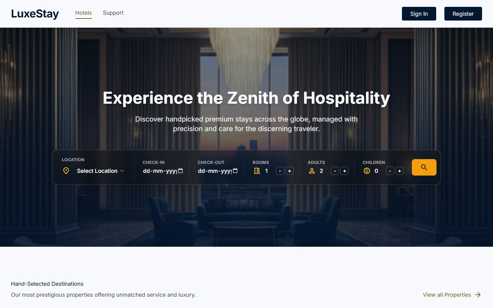

</div>

---

## ✨ Highlights

- **🏢 Multi-tenant by design.** Many hotels on one deployment. Every row carries a `hotel_id`, and every staff action is scoped to the logged-in user's hotel.
- **⏱️ 10-minute room holds.** Selecting rooms locks them in **Redis with a TTL**, so two guests can't pay for the same room; confirming writes the booking inside a **MySQL transaction**.
- **⚡ Real-time front desk.** Check-ins, check-outs and housekeeping push live updates to every screen in that hotel over **Socket.IO** rooms.
- **🧹 Automatic housekeeping.** A checked-out room turns *Dirty* for 15 minutes (Redis timer), then a background worker returns it to *Available*.
- **🧾 GST invoices.** Room charges + incidentals (spa, minibar, laundry…) + 12% GST, as a printable invoice.
- **📊 Four role-based dashboards.** Guest, Front Desk, Hotel Admin and Super Admin, each with its own views and charts.
- **🔐 Secure by default.** bcrypt passwords, JWT in an `httpOnly` + `sameSite=strict` cookie, role guards on every route, reCAPTCHA on login/registration, OTP password reset with a 2-minute expiry.

---

## 🎬 Try it live

**👉 [luxestay-mu9b.onrender.com](https://luxestay-mu9b.onrender.com)**

> Runs on a free instance: the first visit after it has been idle can take **~1 minute** to wake up.

All demo accounts use the password **`Password@123`**.

| Role | Email | Where to sign in |
|---|---|---|
| 🧳 Guest | `guest@hbms.local` | [`/login`](https://luxestay-mu9b.onrender.com/login) → **Guest** tab |
| 🛎️ Front Desk (Coral Bay Resort) | `frontdesk.coralbay@hbms.local` | [`/login`](https://luxestay-mu9b.onrender.com/login) → **Front Desk** tab |
| 🏨 Hotel Admin (Coral Bay Resort) | `admin.coralbay@hbms.local` | [`/login`](https://luxestay-mu9b.onrender.com/login) → **Admin** tab |
| 👑 Super Admin | `superadmin@hbms.local` | [`/superadmin/auth/login`](https://luxestay-mu9b.onrender.com/superadmin/auth/login) |

Every hotel has its own staff logins: `admin.<hotel>@hbms.local` / `frontdesk.<hotel>@hbms.local` with `<hotel>` = `seaview`, `aravalli`, `coralbay`, `palmgrove`, `backwater`, `skyline`, `haveli`, `pinecrest`, `marina`, `capital`.

> Demo data is shared and reset from time to time, so feel free to click around.

---

## 📸 Screenshots

### 🧳 Guest experience

<table>
  <tr>
    <td width="50%">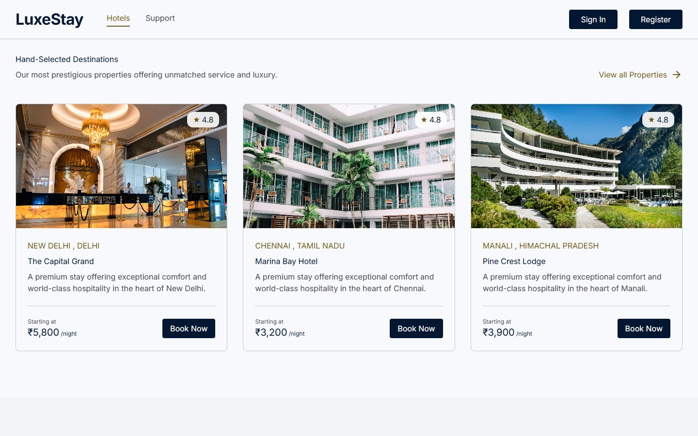<p align="center"><b>Featured hotels</b></p></td>
    <td width="50%">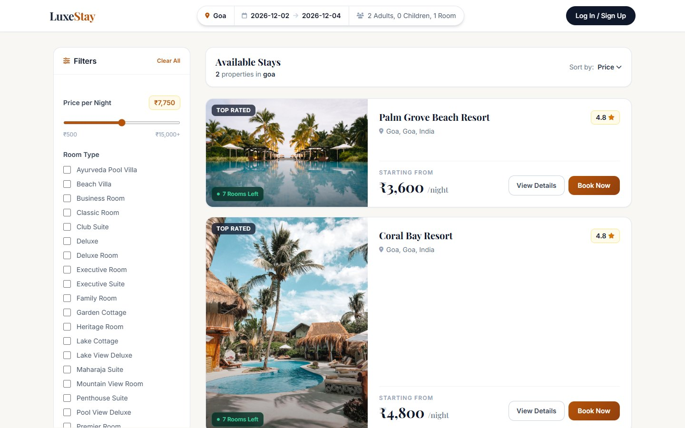<p align="center"><b>Search with price, room-type & amenity filters</b></p></td>
  </tr>
  <tr>
    <td>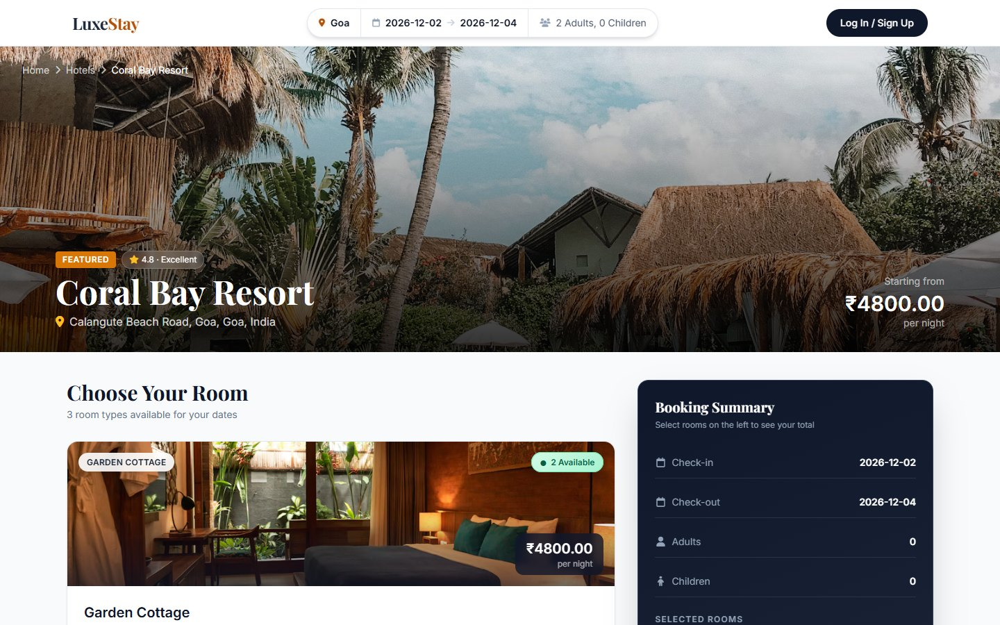<p align="center"><b>Hotel page</b></p></td>
    <td>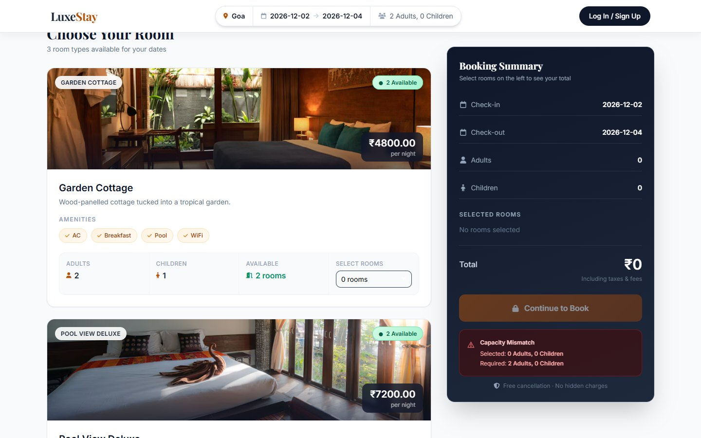<p align="center"><b>Pick rooms → live booking summary</b></p></td>
  </tr>
  <tr>
    <td>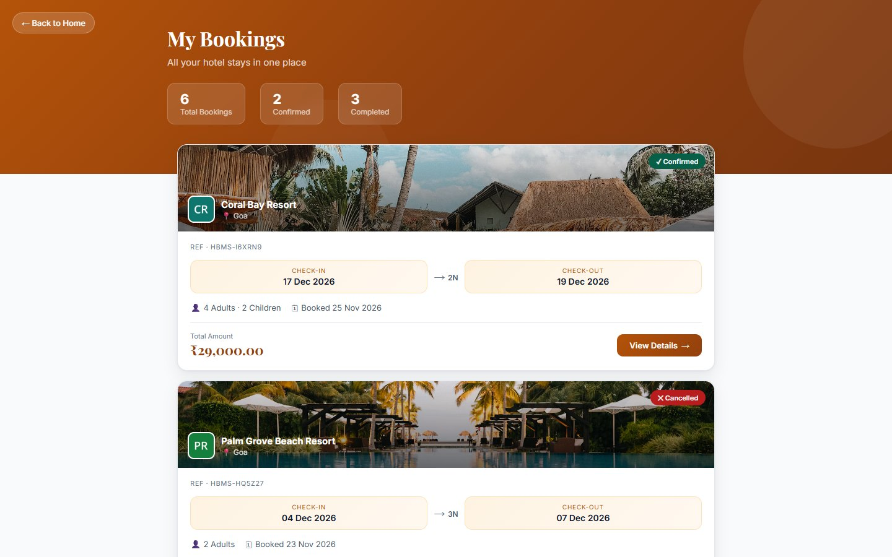<p align="center"><b>My Bookings</b></p></td>
    <td>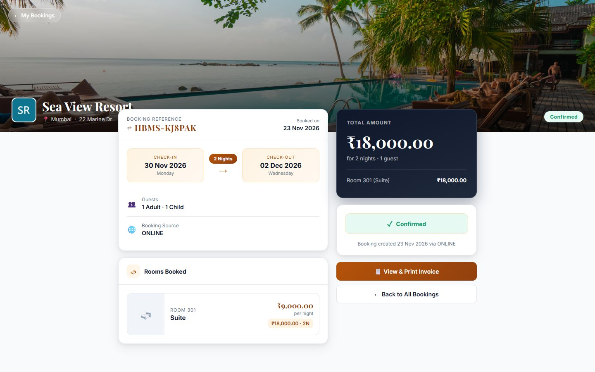<p align="center"><b>Booking detail</b></p></td>
  </tr>
  <tr>
    <td>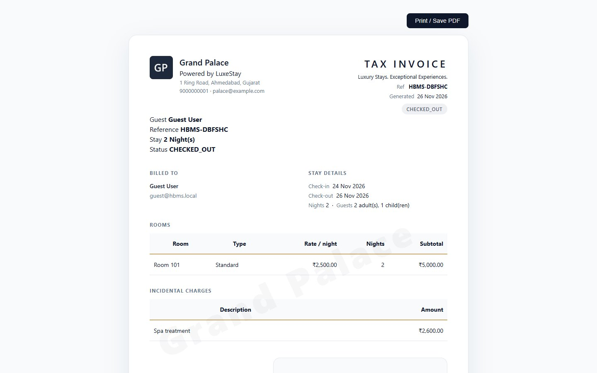<p align="center"><b>Printable GST invoice</b></p></td>
    <td>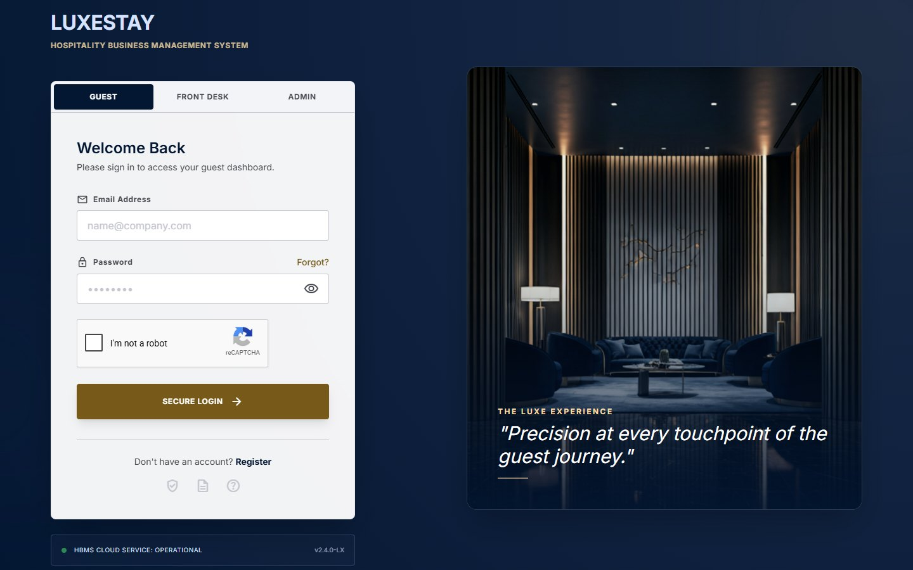<p align="center"><b>Role-based login with reCAPTCHA</b></p></td>
  </tr>
</table>

### 🛎️ Front Desk

<table>
  <tr>
    <td width="50%">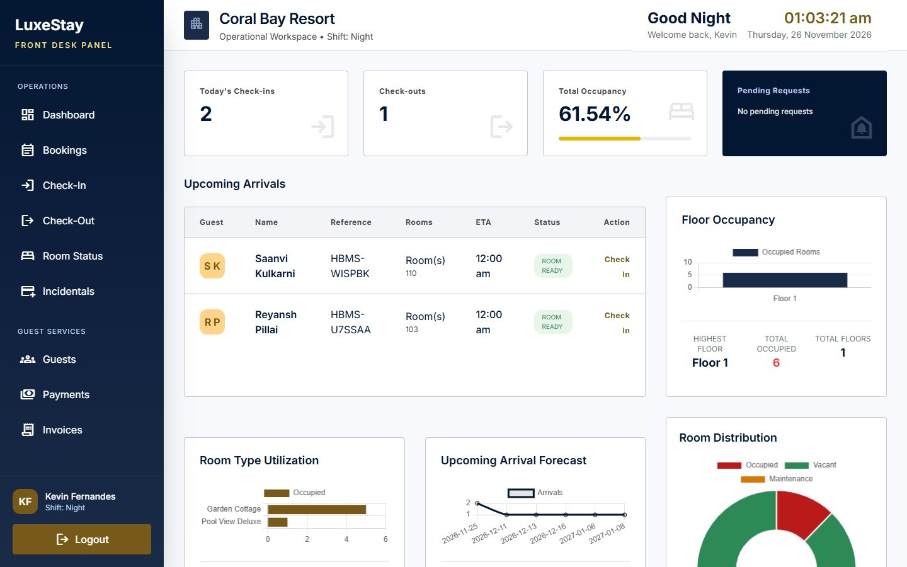<p align="center"><b>Today's arrivals, departures & occupancy</b></p></td>
    <td width="50%">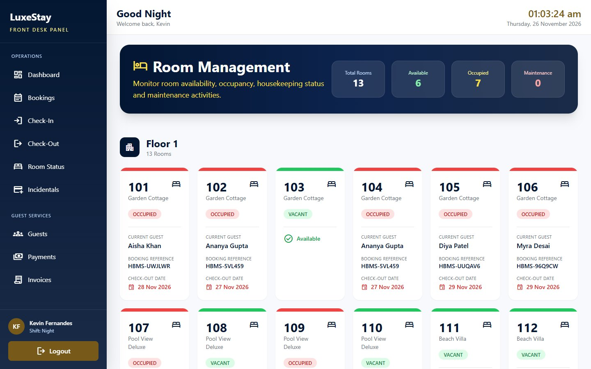<p align="center"><b>Live room status board</b></p></td>
  </tr>
</table>

### 🏨 Hotel Admin

<table>
  <tr>
    <td width="50%">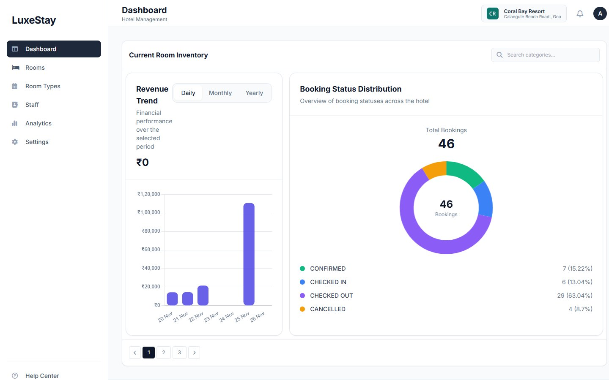<p align="center"><b>Revenue trend & booking mix</b></p></td>
    <td width="50%">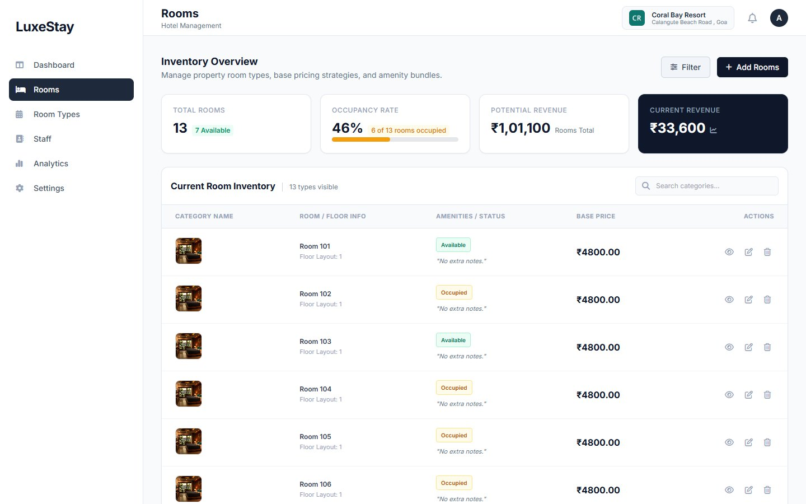<p align="center"><b>Room inventory & KPIs</b></p></td>
  </tr>
</table>

### 👑 Super Admin

<table>
  <tr>
    <td width="50%">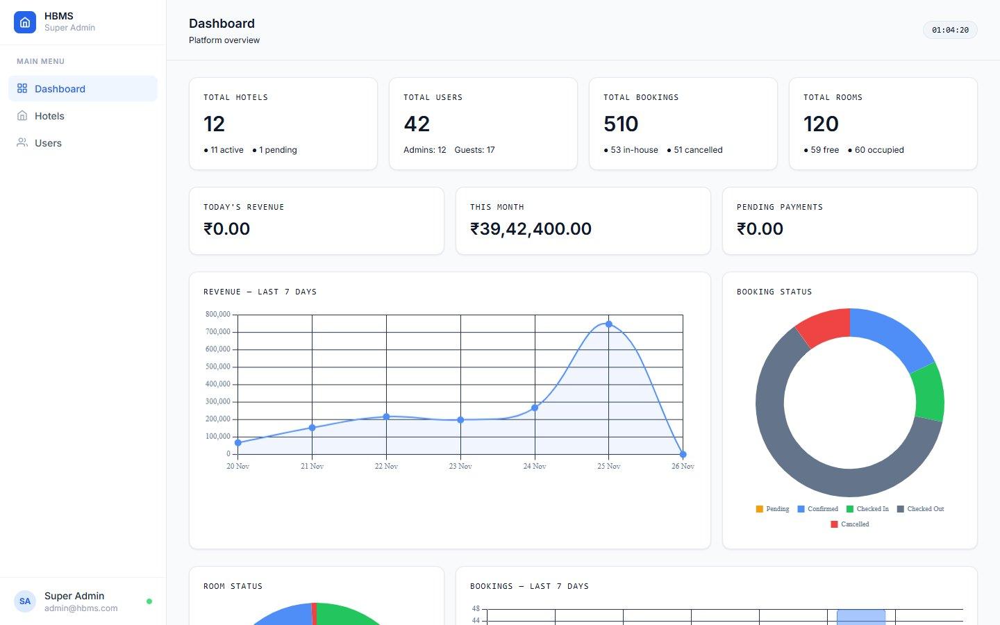<p align="center"><b>Platform-wide dashboard</b></p></td>
    <td width="50%">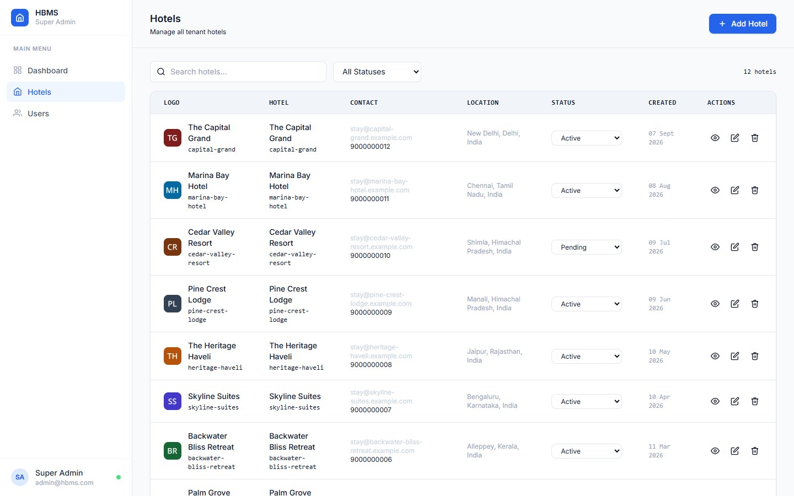<p align="center"><b>Onboard & manage hotels (tenants)</b></p></td>
  </tr>
</table>

---

## 🧩 What each role can do

| 🧳 Guest | 🛎️ Front Desk | 🏨 Hotel Admin | 👑 Super Admin |
|---|---|---|---|
| Search hotels by city, dates & guests | Today's arrivals & departures | Revenue trend (daily / monthly / yearly) | Onboard, edit, suspend hotels |
| Filter by price, room type, amenities | Check-in with ID verification & document upload | Booking status distribution | Platform KPIs & revenue |
| Hold rooms for 10 minutes, then pay | Check-out, room goes to housekeeping | Rooms, room types & amenities | All users across hotels |
| My Bookings, booking detail, notifications | Live room status board | Staff accounts | Booking & room status overview |
| Download GST invoice | Incidental charges (spa, minibar, laundry…) | Cancellation policies per room type | |
| Profile, password reset via OTP | Occupancy & arrival forecast charts | | |

---

## 🏗️ Architecture

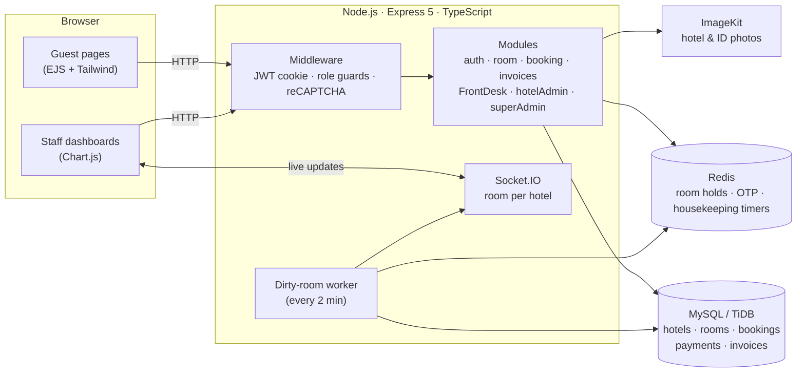

### 🔄 Booking flow

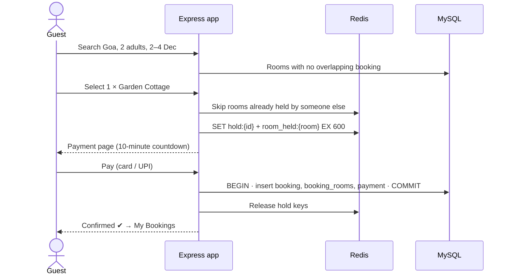

---

## 🛠️ Tech stack

| Layer | Technology |
|---|---|
| **Runtime / framework** | Node.js 24, Express 5, TypeScript (strict) |
| **Views** | EJS server-side rendering, Tailwind CSS, vanilla JS, Chart.js |
| **Database** | MySQL 8 (local) / TiDB Cloud (production, MySQL-compatible) via `mysql2` pool |
| **Cache & timers** | Redis (`ioredis` + `redis`): booking holds, OTPs, housekeeping TTLs |
| **Realtime** | Socket.IO, one room per hotel |
| **Auth & security** | JWT in `httpOnly` cookie, bcrypt, role-based route guards, Google reCAPTCHA v2 |
| **Media** | Multer + ImageKit (hotel images, guest ID documents) |
| **Hosting** | Render (app) · TiDB Cloud (DB) · Upstash (Redis) |

---

## 🚀 Run it locally

**Prerequisites:** Node.js 20+, MySQL 8, Redis (Docker is easiest).

```bash
# 1. Clone and install
git clone https://github.com/prince-1905/hotel-booking-management-system.git
cd hotel-booking-management-system
npm install

# 2. Start Redis
docker run -d --name luxestay-redis -p 6379:6379 redis:7-alpine

# 3. Configure
cp .env.example .env          # set DB_USER / DB_PASS, JWT_SECRET, SESSION_KEY, reCAPTCHA & ImageKit keys

# 4. Create the schema + demo data (12 hotels, 120 rooms, ~500 bookings)
npm run db:seed

# 5. Start the dev server (auto-reload)
npm run dev                   # → http://localhost:3000
```

`npm run db:seed` resets the database from [`sql/local_setup.sql`](sql/local_setup.sql) and generates a year of realistic activity **relative to today**: bookings, payments, invoices, incidentals, today's arrivals and departures. Run it again any time for fresh data.

<details>
<summary><b>Environment variables</b></summary>

See [`.env.example`](.env.example) for the full list.

| Variable | Purpose |
|---|---|
| `DB_HOST`, `DB_PORT`, `DB_USER`, `DB_PASS`, `DB_NAME` | MySQL connection (`DB_NAME=HBMS`) |
| `DB_SSL`, `DB_TIMEZONE` | TLS and session time zone for hosted MySQL (e.g. `true`, `+05:30`) |
| `REDIS_URL` *or* `REDIS_HOST` / `REDIS_PORT` | Redis connection |
| `JWT_SECRET`, `SESSION_KEY`, `SECRET_KEY` | Signing secrets |
| `GOOGLE_SITE_KEY`, `GOOGLE_SECRET` | reCAPTCHA v2 ("I'm not a robot") |
| `IMAGEKIT_PUBLIC_KEY`, `IMAGEKIT_PRIVATE_KEY`, `IMAGEKIT_URL_ENDPOINT` | Image uploads |
| `HOLD_TTL_SECONDS` | Booking hold length (default 600) |

</details>

<details>
<summary><b>Deploying (free tier)</b></summary>

The live demo runs entirely on free tiers:

- **App:** Render web service. [`render.yaml`](render.yaml) describes it (build: `npm ci --include=dev && npm run build`, start: `npm start`).
- **Database:** TiDB Cloud Starter (MySQL-compatible). Load it with
  `npm run db:seed -- --env .env.production --force`
- **Redis:** Upstash (`rediss://` URL in `REDIS_URL`)

</details>

---

## 📁 Project structure

```
src/
├── server.ts                 # HTTP server + Socket.IO bootstrap
├── app.ts                    # Express app, middleware, route mounting
├── config/                   # MySQL pool, Redis clients, session, ImageKit
├── common/                   # auth middleware, JWT, uploads, reCAPTCHA helpers
├── socket/                   # Socket.IO setup (one room per hotel)
├── modules/
│   ├── auth/ · Authen_Guest/ # register, login, profile, OTP reset
│   ├── room/                 # search, filters, hotel details, room holds
│   ├── booking/              # payment flow, My Bookings, notifications
│   ├── invoices/             # GST invoice generation
│   ├── FrontDesk/            # check-in/out, room board, incidentals, worker
│   ├── hotelAdmin/           # rooms, room types, staff, policies, dashboard
│   └── superAdmin/           # tenants (hotels), users, platform dashboard
├── views/                    # EJS templates per role
└── public/                   # client JS & assets
scripts/seed-demo.js          # demo data generator
sql/local_setup.sql           # schema + lookup data
```

---

<div align="center">

Built with ☕ by **[prince-1905](https://github.com/prince-1905)**

If you like the project, a ⭐ on the repo is appreciated!

<sub>Hotel and room photos from <a href="https://unsplash.com">Unsplash</a>. Hotels, people and bookings in the demo are fictional.</sub>

</div>
